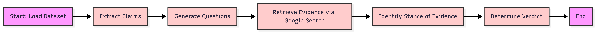
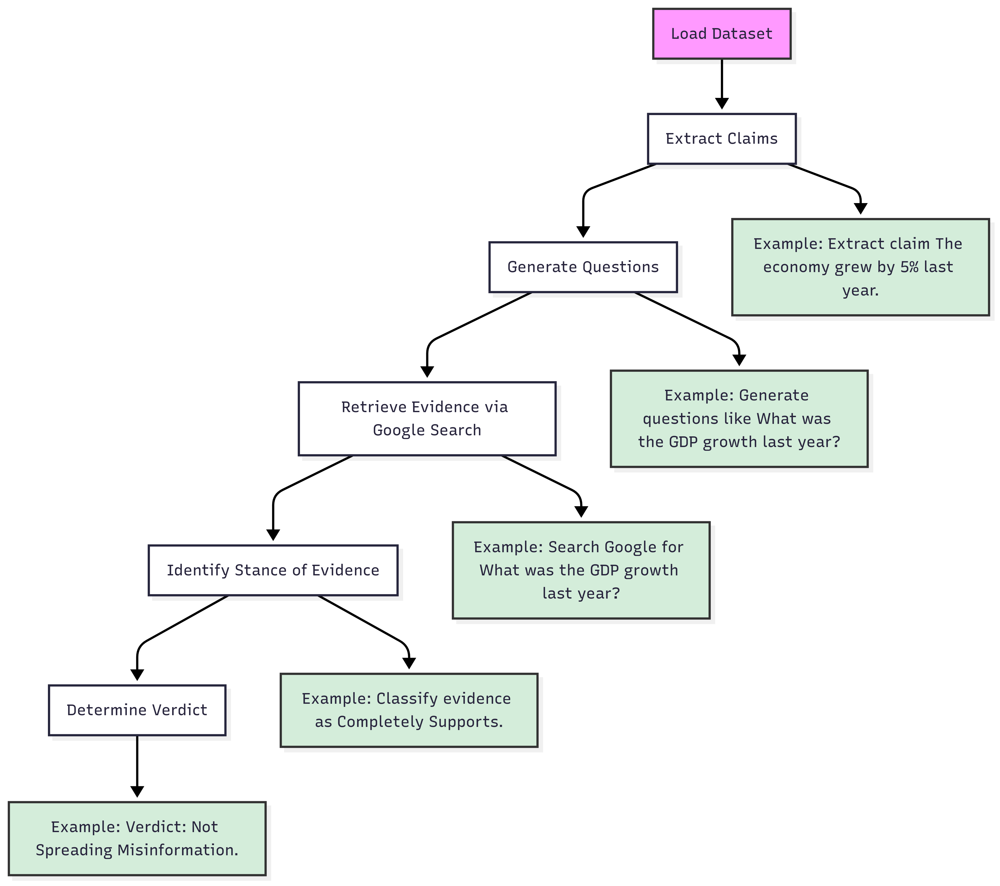

# 🗳️ North Macedonia 2024 Election: Fact-Checking & Sentiment Analysis

*EPFL SHS team project (Law and Computation I & II), Sep 2024 – May 2025*

An end-to-end pipeline that analyses **1,000+ political ads** (Macedonian / Albanian) from the **Meta Ad Library** for five
major parties in the 2024 North Macedonian elections: it **extracts factual claims, retrieves evidence from the web and
reaches a verdict** with a local LLM, and tracks the **sentiment** of each party's messaging over time.

<p align="center">
  
</p>

## ✨ Highlights
- **Multi-stage LLM fact-checking** with **Llama3** (run locally via Ollama): claim extraction → question generation →
  evidence retrieval with the **Google Custom Search API** → stance classification (*Supports / Refutes / Neutral*) →
  aggregated verdict (*True / False / Unverified*).
- **85%+ verdict accuracy**, checked manually by the team on a sample of claims.
- **Sentiment analysis** of 800+ posts with **VADER** after machine translation, with per-party and temporal breakdowns.
- Visualisations of sentiment trends, stance counts and verdict distributions (Matplotlib / Seaborn).

## 🧭 Pipeline
| Step | Notebook / script | What it does |
|---|---|---|
| 1. Preprocessing | `data-preprocessing-pipeline.ipynb` | Loads the Meta Ad Library exports, keeps the ad texts, removes empty/invalid rows |
| 2. Sentiment | `sentiment-analysis-pipeline.ipynb`, `process_sentiment_all.py` | Translates posts to English and scores them with VADER |
| 3. Fact-checking | `fact-checking-pipeline.ipynb` | Llama3 claim extraction → questions → Google Search evidence → stance → verdict |
| 4. Exploration | `dataset-visualization-pipeline.ipynb` | Exploratory analysis of the raw datasets |

Intermediate and final results are in `dataset/` (claims, questions, evidence and final verdicts per party).

## 🚀 Running it
```bash
python -m venv venv && source venv/bin/activate
pip install pandas tqdm requests vaderSentiment googletrans==4.0.0rc1 matplotlib seaborn python-dotenv
cp .env.example .env          # add your Google Custom Search API key
ollama pull llama3            # the fact-checking notebook calls Llama3 on localhost:11434
```
Then run the notebooks in the order above.

## 📊 Example output
<p align="center">
  
</p>
